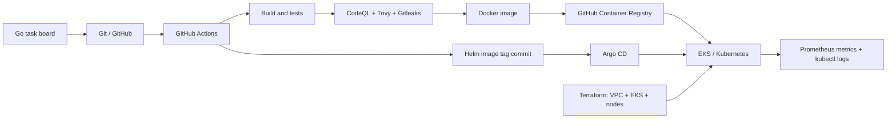

# Session 21: Final DevOps Project & Troubleshooting

A working Go task board carried from source control to a container registry and Kubernetes. Students can use the raw manifests for resource inspection or the Helm chart for GitOps delivery. The default app stores tasks in a PVC, exposes health checks and Prometheus metrics, and accepts authenticated task creation.

## Architecture



## Technologies and layout

Go standard library, Git/GitHub, GitHub Actions, CodeQL, Gosec, Gitleaks, Trivy, Docker, GHCR, Terraform, AWS VPC/EKS, Kubernetes, Helm, Prometheus and Argo CD.

| Directory | Purpose |
| --- | --- |
| `application/` | Task board, API, metrics and tests |
| `docker/` | Multi-stage non-root image |
| `kubernetes/` | Raw resources and broken-resource labs |
| `helm/taskboard/` | Templated deployment |
| `terraform/` | AWS VPC and EKS infrastructure |
| `.github/workflows/` | Quality, security, image and GitOps pipeline |
| `security/` | Gate explanation |
| `monitoring/` | Minimal Prometheus deployment |
| `gitops/` | Argo CD Application |

## Application setup

Requires Go 1.25 or newer. No third-party Go dependencies.

```sh
cd application
go test ./...
API_TOKEN=local-demo-token DATA_FILE=./data/tasks.json go run .
```

Open `http://localhost:8080`. Enter `local-demo-token` in the UI to add a task. API example:

```sh
curl http://localhost:8080/api/tasks
curl -X POST http://localhost:8080/api/tasks -H 'Content-Type: application/json' -H 'Authorization: Bearer local-demo-token' -d '{"title":"Verify CI"}'
curl http://localhost:8080/healthz
curl http://localhost:8080/readyz
curl http://localhost:8080/metrics
```

Data is written atomically to `DATA_FILE`. Logs go to stdout/stderr. `API_TOKEN` is required for writes; the GET API and UI are public in this teaching example.

## Docker setup

From the repo root:

```sh
docker build -f docker/Dockerfile -t taskboard:local .
docker volume create taskboard-data
docker run --rm -p 8080:8080 -e API_TOKEN=local-demo-token -v taskboard-data:/data taskboard:local
```

The final image uses a non-root distroless base. To push manually to GHCR, log in, tag, and push; CI does this automatically after all gates pass.

## Kubernetes deployment

Prerequisites: a cluster with a default StorageClass, `kubectl`, a published GHCR image, and (for Ingress) an ingress-nginx controller. The raw manifest uses the `latest` image tag. Replace the demo Secret first, then apply:

```sh
kubectl apply -f kubernetes/all.yaml
kubectl -n devops-lab create secret generic taskboard-auth --from-literal=API_TOKEN='choose-a-unique-token' --dry-run=client -o yaml | kubectl apply -f -
kubectl -n devops-lab rollout status deployment/taskboard
kubectl -n devops-lab port-forward service/taskboard 8080:80
```

Run the port-forward in its own terminal and visit `http://localhost:8080`. The sample Ingress host is `taskboard.example.test`; point that host to your controller and configure TLS before internet exposure. To install ingress-nginx: `helm upgrade --install ingress-nginx ingress-nginx --repo https://kubernetes.github.io/ingress-nginx --namespace ingress-nginx --create-namespace` ([official guide](https://kubernetes.github.io/ingress-nginx/deploy/)). The HPA requires Metrics Server ([official chart](https://github.com/kubernetes-sigs/metrics-server/blob/master/charts/metrics-server/README.md)).

The PVC is `ReadWriteOnce`; the app stores a single JSON file and is intentionally limited to one replica. The HPA demonstrates the resource and CPU target but `maxReplicas: 1` prevents unsafe concurrent writes. For real horizontal scaling, move task data to a database, then raise the HPA maximum.

## Helm deployment

Use either raw manifests **or** Helm for the task board in one namespace, because both define equivalent resources. Helm expects a preexisting Secret:

```sh
kubectl create namespace devops-lab --dry-run=client -o yaml | kubectl apply -f -
kubectl -n devops-lab create secret generic taskboard-auth --from-literal=API_TOKEN='choose-a-unique-token'
helm lint helm/taskboard
helm upgrade --install taskboard helm/taskboard -n devops-lab --set image.tag=latest
kubectl -n devops-lab rollout status deployment/taskboard
```

For Ingress, add `--set ingress.enabled=true --set ingress.host=your.example.com`. For a non-default StorageClass, set `storage.storageClassName`. GHCR may mark a newly created package private; make it public in package settings or configure an image pull secret before deploying.

## Terraform infrastructure

`terraform/` provisions a two-AZ VPC, public/private subnets, NAT gateway, EKS managed node group, core add-ons and EBS CSI driver. Requires Terraform >=1.6, AWS CLI, AWS credentials with sufficient permissions, and a supported EKS version in the chosen region. AWS resources incur charges until destroyed. State is local by default; configure a protected remote backend before team use.

```sh
cd terraform
cp terraform.tfvars.example terraform.tfvars
terraform init
terraform fmt -check
terraform validate
terraform plan
terraform apply
aws eks update-kubeconfig --region ap-south-1 --name session21-devops
kubectl get nodes
```

Review the plan and region/version before `apply`. Run `terraform destroy` from the same directory when finished. The Terraform configuration does not automatically install Argo CD, ingress-nginx or Metrics Server; install those cluster components separately.

## CI/CD pipeline and DevSecOps

`.github/workflows/ci-cd.yml` runs on pull requests and `main` pushes. Test, Helm lint/render, Terraform validation, Gosec SAST, CodeQL analysis, Trivy filesystem SCA and Gitleaks history scanning must all pass. Gosec fails on high-severity/high-confidence findings; CodeQL alerts require a code scanning ruleset to act as a PR gate. On `main`, the pipeline builds the Docker image, blocks HIGH/CRITICAL image findings, pushes immutable SHA and `latest` tags to GHCR, then commits that SHA into Helm values. Argo CD sees the Helm commit and deploys it. This is the Kubernetes deployment step: CI changes desired state; Argo CD performs cluster reconciliation. No cluster credentials are stored in GitHub Actions.

The GitOps commit is authored as `Yeagerist0 <180412661+Yeagerist0@users.noreply.github.com>`. GitHub Actions still appears as the push actor. To enforce gates, mark `test`, `sast`, `sca` and `secrets` as required checks in branch protection. If branch protection blocks bot writes to `main`, configure a deployment branch or a reviewed pull request for Helm value changes. See [`security/README.md`](security/README.md) for details.

## Monitoring and logs

The app exposes `/metrics` in Prometheus text format. For a small lab:

```sh
kubectl apply -f monitoring/prometheus.yaml
kubectl -n monitoring port-forward service/prometheus 9090:9090
```

Open `http://localhost:9090` and query `app_http_requests_total`, `app_tasks_created_total`, or `app_tasks_stored`. Prometheus in this demo uses ephemeral storage, so historical metrics disappear when its pod is recreated. Application logs and Kubernetes events are available with:

```sh
kubectl -n devops-lab logs deployment/taskboard --tail=100
kubectl -n devops-lab get events --sort-by=.lastTimestamp
kubectl -n devops-lab describe deployment taskboard
```

## GitOps workflow

Install [Argo CD](https://argo-cd.readthedocs.io/en/latest/getting_started/), then create the app Secret and apply `gitops/application.yaml`:

```sh
kubectl create namespace argocd
kubectl apply -n argocd --server-side --force-conflicts -f https://raw.githubusercontent.com/argoproj/argo-cd/stable/manifests/install.yaml
kubectl create namespace devops-lab
kubectl -n devops-lab create secret generic taskboard-auth --from-literal=API_TOKEN='choose-a-unique-token'
kubectl apply -f gitops/application.yaml
kubectl -n argocd get application taskboard
```

If the namespace or Secret already exists, keep it. Argo CD targets `helm/taskboard` on `main`, auto-syncs and repairs drift. A successful CI run changes `image.tag` to its commit SHA. The GHCR package must be readable by the cluster. Do not also run `kubectl apply -f kubernetes/all.yaml` against the same release.

## Troubleshooting challenge

Five isolated broken-resource patches are in [`kubernetes/challenges/`](kubernetes/challenges/README.md): bad image, absent ConfigMap, bad readiness path, Service label mismatch and absent Secret. Apply each in a disposable cluster, investigate pods/events/logs/endpoints, fix it, and verify `/healthz`, the API and metrics. Copy `TEMPLATE.md` for each incident. The instructor answer key is separate in `ANSWERS.md`.

## Screenshots

The local application screenshot is in [`screenshots/taskboard-local.png`](screenshots/taskboard-local.png). Capture your own CI run, GHCR package, Argo CD sync and Prometheus query after deploying; those screens depend on your GitHub and cluster and are not prefilled here.

## Lessons learned

- A passing build is only one gate; test, source, dependency, secret and image checks each catch different failures.
- Git holds desired deployment state, so a release can be audited and reconciled by Argo CD.
- Kubernetes events and resource descriptions often explain startup failures before application logs exist.
- Persistent single-file storage changes the scaling design; HPA needs a shareable data layer before multiple replicas are safe.
